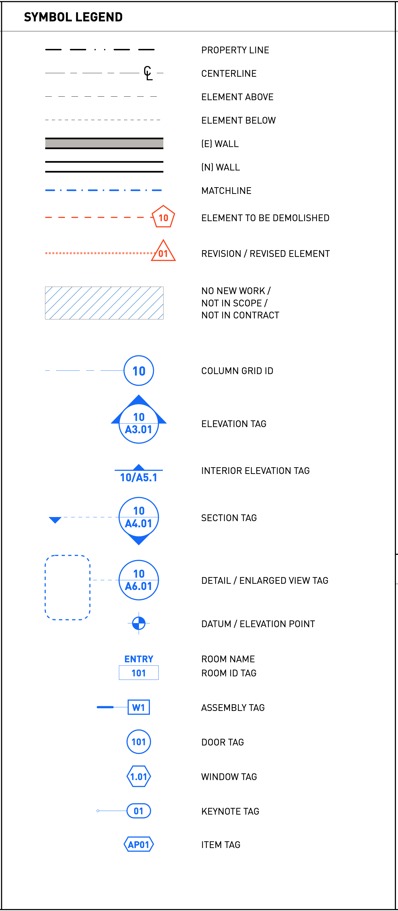

# Drawing Callouts and Reference Symbols

**Last revised:** November 24, 2026

Use consistent symbols to distinguish drawing references, item identifiers, line meanings, and work conditions.

## Drawing References

A drawing reference identifies **the target drawing and the sheet where it appears**.

- In divided circular markers, place the drawing identifier above the line and the sheet number below.
- In compact references, use **drawing/sheet**, such as `3/A3.01`.
- Use the actual drawing identifier, including lettered section identifiers such as `AA`, `BB`, or `CC`.
- Use the project's sheet-number format, such as `A4.1` or `A4.01`.

| Symbol | Graphic | Use |
| --- | --- | --- |
| Elevation Tag | Divided circle with a filled triangular direction indicator | Identifies the elevation view and destination sheet; the indicator shows the viewing direction |
| Interior Elevation Tag | Small filled triangular indicator on a horizontal line, with a compact drawing/sheet reference | Identifies an interior elevation and its viewing direction |
| Section Tag | Divided circular reference head, filled direction indicator, and section line/tail | Locates the cut and identifies the section drawing, sheet, and viewing direction |
| Detail / Enlarged View Tag | Dashed boundary around the referenced area, connected to a divided circular marker | Identifies the area enlarged or detailed and the destination drawing and sheet |

Examples: `AA/A4.01` refers to Building Section AA on A4.01; `5/A6.01` refers to Drawing 5 on A6.01.

## Identification Symbols

| Symbol | Graphic | Identifies |
| --- | --- | --- |
| Column Grid ID | Circle at the end of a gridline | Grid reference |
| Datum / Elevation Point | Quartered circular target with crossing axes | Reference point for an elevation or datum |
| Room Name / Room ID | Room name above a rectangular number box | Room name and unique room identifier |
| Assembly Tag | Square identifier box with a leader where needed | Wall, floor, roof, ceiling, or specialty construction assembly: `W1`, `F2`, `R01`, etc. |
| Door Tag | Circle | Door instance |
| Window Tag | Hexagon | Window instance |
| Keynote Tag | Rounded capsule, with a leader where needed | Numeral in the same sheet's keynote list |
| Item Tag | Elongated hexagon | General item identifier: two-letter category designator immediately followed by one or two numerals; no separator |

Symbol shape identifies the kind of reference; the text inside carries the applicable identifier. General Item Tags use two-letter category codes followed immediately by one or two numerals, such as `AP1` or `AP01`. Square Assembly Tags use a single category letter followed immediately by one or two numerals, such as `W1` or `R01`.

Keynotes use numerals only. Schedule IDs include a hyphen for readability (`AP-01`); the corresponding drawing tag omits it (`AP01`). Foundation conditions use detail references rather than a foundation assembly tag. Windows, doors, lights, and fans retain their category-specific tags.

## Lines and Work Conditions

| Symbol | Graphic Convention | Meaning |
| --- | --- | --- |
| Property Line | Heavy patterned line with long dashes and paired dots | Property boundary |
| Centerline | Thin long/short patterned line with centerline notation | Center of an element or alignment |
| Element Above | Dashed line | Element above the view's reference plane |
| Element Below | Short-dashed line | Element below the view's reference plane |
| Existing Wall | Parallel solid boundary lines with gray fill | Existing wall |
| New Wall | Parallel solid boundary lines without the existing-wall gray fill | New wall; other assembly information is shown separately |
| Matchline | Blue dash-dot line | Continuation of a drawing in another view or sheet; provide the corresponding reference |
| Demolition | Orange dashed element line with a pentagonal identifier | Element to be demolished |
| Revision / Revised Element | Dotted highlight line with a triangular revision identifier | Revised element or area |
| No New Work / Not in Scope / Not in Contract | Blue diagonal hatch | Area excluded from the indicated work; label the applicable condition |

## Reference Coordination

- Match each callout to the target drawing identifier and sheet number.
- Update references when drawings move or sheets are renumbered.
- Keep reference symbols distinct from item tags and keynote markers.
- Check legibility at the intended printed sheet size, including when printed in grayscale.

## Symbol Legend

Use the symbol shapes and line conventions below. The identifiers are examples; use the actual drawing, sheet, item, assembly, and keynote references for the project.

## Related Standards

[Drawing Set Organization](drawing-set-organization.md) · [Drawing Title Naming Convention](drawing-naming.md) · [Drawing Notes and Tags](drawing-notes-and-tags.md) · [General Schedule Identification Protocol](../schedules/general-schedule-identification-protocol.md)
